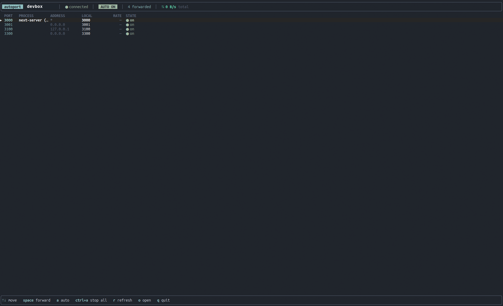

# autoport

`autoport` is a dynamic SSH port forwarder with a small terminal UI. Point it
at a host you can already SSH into, and it discovers listening TCP ports on the
remote machine so you can forward them to localhost manually or automatically.

It is meant to feel like VS Code's automatic port forwarding without requiring
VS Code.

Maintained at [YanxiChen-gh/autoport](https://github.com/YanxiChen-gh/autoport),
based on [Havnevej/autoport](https://github.com/Havnevej/autoport) at
`a7a2b2e9ab4d0ed3f9de864338d80dbd644803a5`. The original MIT license is preserved.

## Features

- Discovers remote listening TCP ports with `ss` or `netstat`.
- Uses OpenSSH directly, so your existing `~/.ssh/config`, keys, agent, and
  known hosts continue to work.
- Reuses one SSH ControlMaster and adds or removes `-L` forwards at runtime.
- Supports manual forwarding or auto-forwarding every discovered port.
- Binds local listeners to `127.0.0.1` only.
- Handles IPv4 and IPv6 loopback services, including tools that bind to `::1`.
- Shows live per-forward and total throughput when local `ss` exposes TCP byte
  counters.
- Falls back to another local port if the matching local port is already busy.

## Showcase

Run `autoport` against any host you can already SSH into:

```sh
autoport devbox --min-port 3000 --max-port 3300
```



In auto-forward mode, `autoport` keeps the remote port list in sync and opens
localhost forwards as services appear. If a matching local port is already in
use, it picks the next available local port instead of failing the whole session.

The screenshot above is from a live run where `autoport` discovered remote dev
services, enabled auto-forwarding, and successfully forwarded `localhost:3000`.

## Requirements

- Rust toolchain for building from source.
- OpenSSH client with ControlMaster support.
- SSH access to the target host before starting `autoport`.
- `ss` on the remote host for best process/port detection, or `netstat` as a
  fallback.
- `ss` locally for live throughput display. Forwarding still works without it.
- `xdg-open` on Linux or `open` on macOS for the `o` key.

## Install

Prebuilt Linux and macOS binaries for x86_64 and ARM64 are attached to each
GitHub Release.

Quick install for Linux or macOS:

```sh
curl -fsSL https://raw.githubusercontent.com/YanxiChen-gh/autoport/main/install.sh | sh
```

Set `BINDIR` to choose another install directory:

```sh
curl -fsSL https://raw.githubusercontent.com/YanxiChen-gh/autoport/main/install.sh | BINDIR=/usr/local/bin sh
```

For x86_64 Linux:

```sh
curl -LO https://github.com/YanxiChen-gh/autoport/releases/latest/download/autoport-linux-x86_64.tar.gz
tar -xzf autoport-linux-x86_64.tar.gz
install -m 0755 autoport-linux-x86_64/autoport ~/.local/bin/autoport
```

For ARM64 Linux, use `autoport-linux-aarch64.tar.gz` instead. For macOS, use
`autoport-macos-aarch64.tar.gz` on Apple Silicon or
`autoport-macos-x86_64.tar.gz` on Intel.

To verify a download:

```sh
curl -LO https://github.com/YanxiChen-gh/autoport/releases/latest/download/SHA256SUMS
sha256sum -c SHA256SUMS --ignore-missing
```

On macOS, use `shasum -a 256 -c SHA256SUMS --ignore-missing`.

From the repository:

```sh
cargo install --path .
```

Or build a release binary:

```sh
cargo build --release
```

You can also use the included Makefile:

```sh
make install
```

By default, `make install` copies the binary to `~/.local/bin`. Override the
destination with `BINDIR`:

```sh
make install BINDIR=/usr/local/bin
```

To install this repository directly with Cargo:

```sh
cargo install --git https://github.com/YanxiChen-gh/autoport --locked
```

## Usage

```sh
autoport [USER@]HOST [options]
```

Options:

```text
--interval SECS   how often to rescan remote ports (default 4)
--min-port N      lowest remote port to show (default 1024)
--max-port N      highest remote port to show (default 65535)
-h, --help        show help
```

Examples:

```sh
autoport devbox
autoport user@example.com --min-port 3000 --max-port 9999
autoport staging --interval 2
```

## Keys

```text
Up/Down, j/k   navigate
space          forward or unforward the selected port in manual mode
a              toggle auto-forwarding
Ctrl+A         turn auto-forwarding off and stop all forwards
r              rescan now
o              open the selected forwarded port in a browser
q, Esc         quit
```

## How It Works

`autoport` starts a background OpenSSH master connection:

```text
ssh -f -N -M -S <socket> <host>
```

It then polls the remote host for listening TCP sockets and uses OpenSSH control
commands to add or remove forwards dynamically:

```text
ssh -S <socket> -O forward -L 127.0.0.1:<local>:<target>:<remote> <host>
ssh -S <socket> -O cancel  -L 127.0.0.1:<local>:<target>:<remote> <host>
```

The first connection is interactive so passphrase or password prompts work
normally. Reconnect attempts use batch mode so the TUI does not hang waiting for
input.

## Troubleshooting

- If connection fails immediately, verify that `ssh HOST` works outside
  `autoport` first.
- If no ports appear, verify that the remote host has `ss` or `netstat` and that
  the ports are inside the configured range.
- If a forward fails, the matching local port may already be taken or SSH may be
  unable to reach the remote bind address.
- If throughput stays at `0 B/s` or `-`, local TCP byte counters may be
  unavailable. This does not affect forwarding.

## Benchmarking

The repository includes a benchmark script for comparing many forwards over one
SSH ControlMaster against one SSH connection per forward:

```sh
make bench HOST=devbox
```

Useful knobs:

```sh
MODE=both MAX=32 SIZE_MB=256 ROUNDS=3 make bench HOST=devbox
```

The benchmark starts disposable HTTP firehose servers on the remote host and
cleans them up on exit.

## Releases

CI runs formatting, Clippy, tests, a release build, and crate packaging on every
push to `main` and on pull requests.

To publish a new release:

1. Bump `version` in `Cargo.toml` and run `cargo check` to regenerate `Cargo.lock`.
2. Commit and push the change to `main`.
3. Create and push a matching tag, for example `git tag v0.2.0 && git push origin v0.2.0`.

The release workflow verifies that the tag matches `Cargo.toml`, builds Linux
and macOS binaries for `x86_64` and `aarch64`, generates GitHub release notes,
and publishes the tarballs plus `SHA256SUMS`. The imported `CHANGELOG.md`
preserves upstream release history.

The release workflow can also be run manually with an existing tag to rebuild or
backfill release assets.

## License

MIT. See `LICENSE`.
